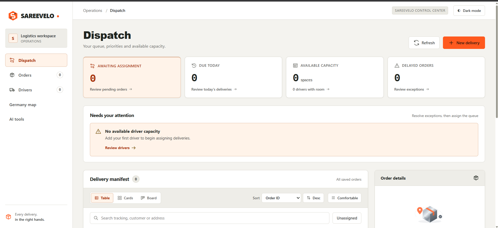
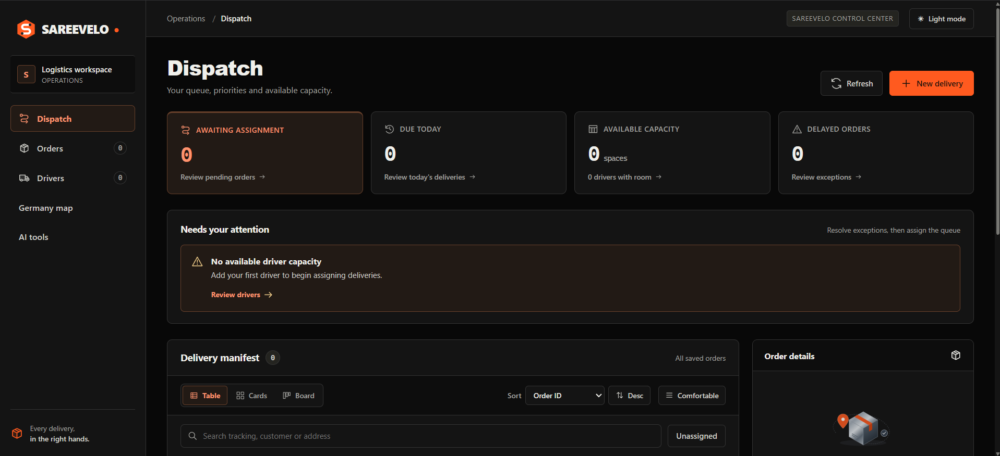
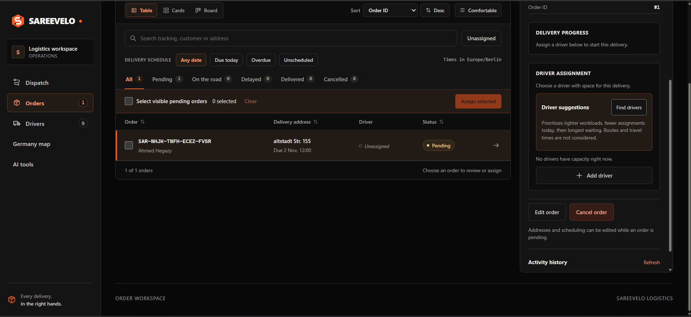
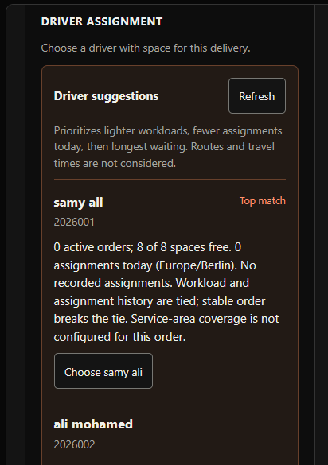
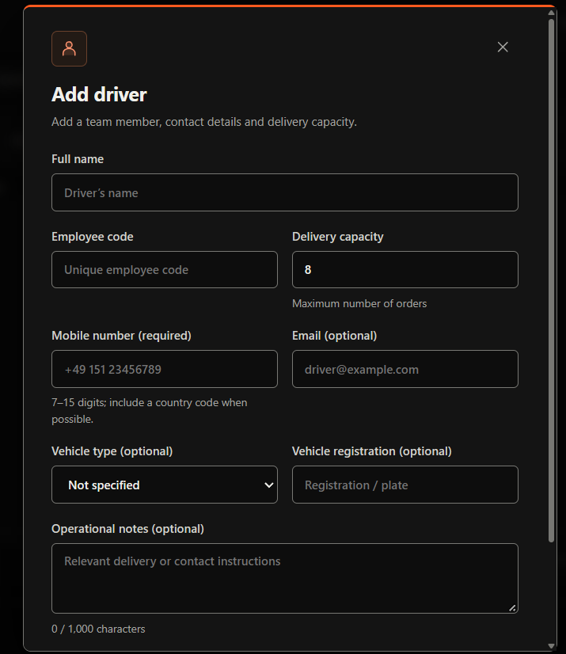
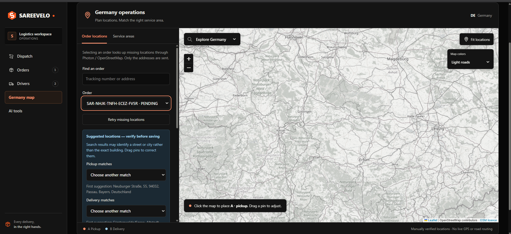
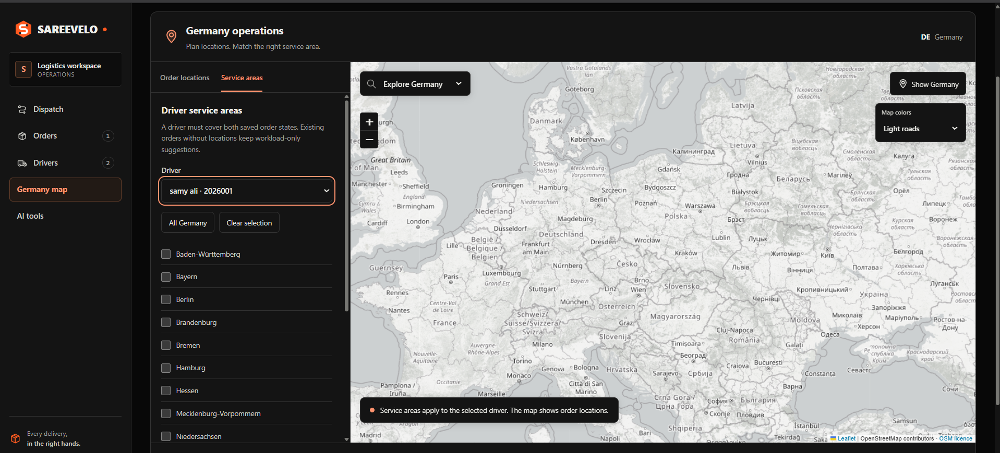
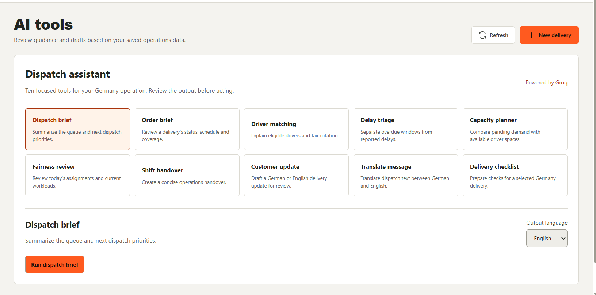

# Sareevelo Logistics Control Center

A Germany-focused dispatch application built with Angular, Spring Boot and PostgreSQL. Dispatchers manage orders, driver capacity, delivery progress and map locations, with optional Groq-assisted explanations and operational drafts.

## Features

- Order creation, scheduling, cancellation and delivery progress.
- Driver profiles, capacity, state coverage and transactional assignment.
- Driver suggestions based on workload and recorded assignment history.
- Germany address lookup, editable pickup/delivery pins and versioned map saves.
- OpenStreetMap-based maps with light/dark styles and touchpad zoom.
- Ten logistics AI features with Markdown output and labeled fallbacks.
- Production API roles, CSRF protection, provider limits and request timing logs.

AI output requires dispatcher review. Driver ranking does not calculate travel times or optimize routes.

## Repository

```text
frontend/          Angular application and Nginx container
backend/           Spring Boot API, Maven wrapper and database scripts
docs/              Architecture, deployment and implementation checklist
postman/specs/     API contracts
compose.yaml       Local Docker stack
.env.example       Docker environment template
```

## Run with Docker

Install Docker Desktop and enable Linux containers. From the repository root:

```powershell
Copy-Item .env.example .env
```

Edit `.env`: set a strong `POSTGRES_PASSWORD`. Optionally set `GROQ_API_KEY` to enable AI generation. Do not overwrite an existing configured `.env`. Secrets are ignored by Git and excluded from container builds.

```powershell
docker compose config --quiet
docker compose up --build -d
docker compose ps
```

Open **http://localhost:3000**. The new Docker database starts empty; existing local PostgreSQL data is not imported or deleted. Create drivers and orders through the app.

```powershell
docker compose logs --tail 100
docker compose down
```

Stopping preserves the database volume. Avoid `down -v` unless you intend to delete the Docker database.

The supplied stack is a **local demo**, bound to loopback. The images were built locally and all three containers passed their health checks. The frontend, proxied API health and empty orders response were verified on 31 October 2026. Public deployment requires the production setup described in [deployment](docs/deployment.md).

## Run without Docker

From the repository root, `npm run install:frontend` installs frontend dependencies and `npm start` starts the frontend. These shortcuts forward to `frontend/`; start the backend separately as described below.

Requirements: Node.js 22, Java 17 and PostgreSQL. Create a database and configure `backend/.env` using `backend/.env.example` (database URL, user and password; Groq is optional).

Backend terminal:

```powershell
cd backend
.\mvnw.cmd spring-boot:run
```

Frontend terminal:

```powershell
cd frontend
npm ci
npm start
```

Open **http://localhost:4200**. The frontend proxies API calls to **127.0.0.1:9090**. On macOS/Linux use `./mvnw` instead of `mvnw.cmd`.

## Build checks

```powershell
cd frontend
npm run build:production
npm audit --omit=dev --audit-level=high
cd ../backend
.\mvnw.cmd clean package -Dmaven.test.skip=true
```

CI builds both applications and container images and audits frontend runtime dependencies. Test suites and mock fixtures were removed at the project owner's request; build checks do not establish behavioral correctness.

## Screenshots

### Dashboard — light theme


### Dashboard — dark theme


### Orders


### Driver assignment


### Add a driver


### Germany order map


### Driver service areas


### AI assistance


## Engineering documentation

- [Architecture](docs/architecture.md)
- [Deployment and security](docs/deployment.md)
- [Implementation plan](docs/implementation-plan.md)
- [Verification checklist](docs/verification-checklist.md)
- [Engineering review and limitations](docs/engineering-review.md)
