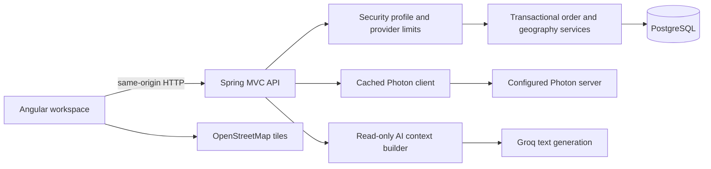

# Architecture

The browser never receives the Groq key. It renders escaped Markdown through Angular sanitization. Lookup candidates are unconfirmed drafts until a dispatcher saves them. Request cancellation prevents a previous selection's HTTP response from replacing the current selection. Leaflet is loaded on demand.

Assignment locks order and driver records, validates status/capacity/coverage, then records the assignment in one transaction. Germany geography also locks the order and requires the latest version. Coverage selection is filtered in SQL. Time-based fairness uses Europe/Berlin day boundaries and recorded assignment events, including completed/cancelled orders.

External provider calls use connection/read timeouts and bounded local limits. Failed AI calls return labeled local guidance; failed translations are unavailable rather than fabricated. Geocoder matches/misses have a bounded one-day in-memory cache; errors expire quickly. These mechanisms are per process, not distributed coordination.

Production authentication uses Spring Security Basic authentication over HTTPS and BCrypt hashes for configured viewer/dispatcher accounts. CSRF cookies and Angular headers protect writes. Local development is explicitly unauthenticated and loopback-only. The production profile fails on missing account configuration and validates the database schema.

See [engineering-review.md](engineering-review.md) for known limits and [deployment.md](deployment.md) for configuration.
